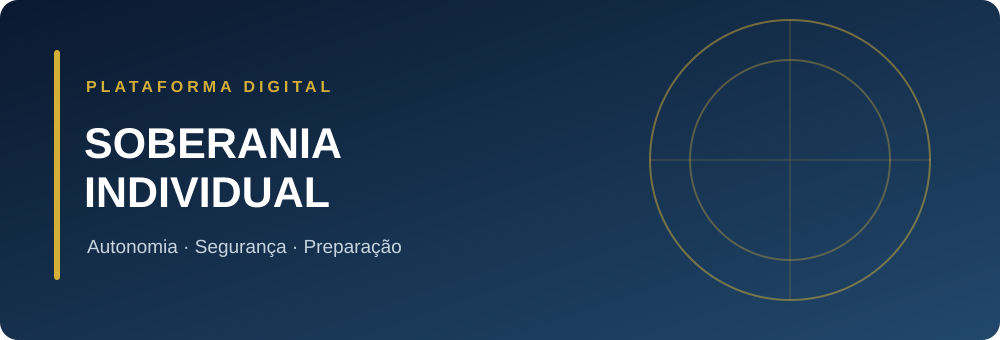
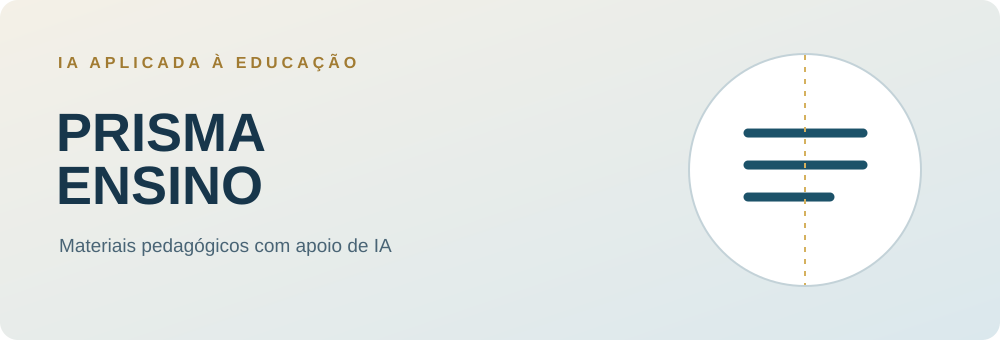
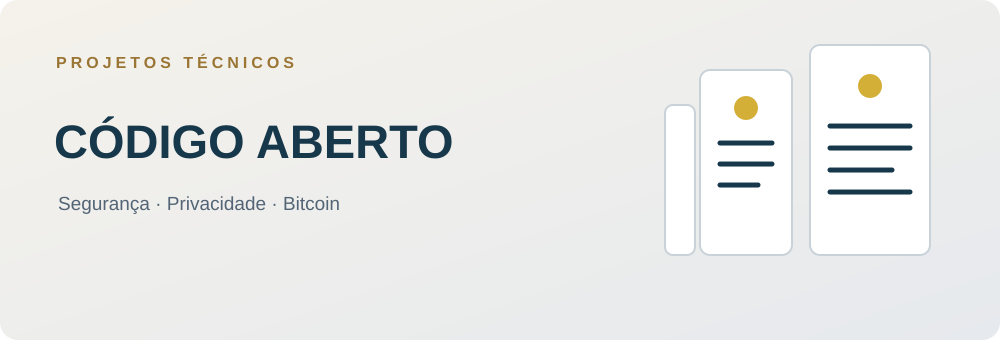

  

  

  <a href="https://lordjunnior.com.br/"><strong>PORTFÓLIO</strong></a>
  &nbsp; · &nbsp;
  <a href="https://github.com/lordjunnior?tab=repositories"><strong>EXPLORAR REPOSITÓRIOS</strong></a>
  &nbsp; · &nbsp;
  <a href="https://lordjunnior.com.br/ferramentas"><strong>FERRAMENTAS AUTORAIS</strong></a>
  &nbsp; · &nbsp;
  <a href="https://lordjunnior.com.br/"><strong>CONTATO</strong></a>

<table>
  <tr>
    <td width="28%" valign="top">
      
    </td>
    <td width="72%" valign="top">

# Desenvolvimento web, design de produto e IA aplicada

**Eu conecto estratégia, experiência do usuário, design e código para transformar ideias em produtos digitais funcionais.**

Sou desenvolvedor independente, designer e educador digital em Santa Catarina, Brasil. Desde 2008 trabalho com design e motion; hoje amplio essa experiência para aplicações web, automações, inteligência artificial aplicada e produtos próprios.

Minha forma de trabalhar resolve um problema comum: quando estratégia, interface, desenvolvimento e publicação ficam desconectados, o produto perde clareza. Eu consigo conduzir essas etapas de forma integrada, mantendo o objetivo do projeto visível do primeiro esboço ao deploy.

**O que isso significa na prática:** menos ruído entre disciplinas, decisões de produto mais coerentes e soluções pensadas tanto para quem usa quanto para quem precisa manter e evoluir o sistema.

    </td>
  </tr>
</table>

---

## Projetos em destaque: produtos reais, código e execução

Estes projetos mostram diferentes capacidades: construir uma plataforma, resolver uma necessidade específica, estruturar uma experiência de usuário e levar uma aplicação até a publicação.

<table>
  <tr>
    <td width="50%" valign="top">
      
      <h3><a href="https://lordjunnior.com.br/">01 · Soberania Individual</a></h3>
      Plataforma editorial com ferramentas interativas sobre autonomia financeira, segurança digital, autocustódia e preparação pessoal. Reúne conteúdo, interface, aplicações e experiências próprias em um único produto.
      
<code>React</code> <code>TypeScript</code> <code>Vite</code> <code>Tailwind CSS</code>

      <a href="https://lordjunnior.com.br/">Acessar produto →</a> · <a href="https://github.com/lordjunnior/meusite">Ver código →</a>
    </td>
    <td width="50%" valign="top">
      
      <h3><a href="https://prisma-ensino.vercel.app/">02 · Prisma Ensino</a></h3>
      Aplicação educacional voltada ao trabalho docente, com fluxos para apoiar a criação de exercícios personalizados alinhados à BNCC e a produção de materiais pedagógicos.
      
<code>React</code> <code>TypeScript</code> <code>Vite</code> <code>IA aplicada</code>

      <a href="https://prisma-ensino.vercel.app/">Acessar aplicação →</a> · <a href="https://github.com/lordjunnior/PrismaEnsino">Ver código →</a>
    </td>
  </tr>
  <tr>
    <td width="50%" valign="top">
      
      <h3><a href="https://lordtecaretro.vercel.app/">03 · LordTecaRetro</a></h3>
      Projeto de entretenimento retrô com experiência de acesso pelo navegador. Uma demonstração de como organizar uma ideia de nicho em uma experiência digital navegável.
      
<code>React</code> <code>TypeScript</code> <code>Vite</code> <code>Express</code> <code>Firebase</code>

      <a href="https://lordtecaretro.vercel.app/">Acessar projeto →</a> · <a href="https://github.com/lordjunnior/LordTecaRetro">Ver código →</a>
    </td>
    <td width="50%" valign="top">
      
      <h3><a href="https://github.com/lordjunnior/right-time">04 · Right Time</a></h3>
      Ferramenta de controle de jornada com cálculo de horas, registro fotográfico com timestamp e exportação de relatório para o RH.
      
<code>React</code> <code>TypeScript</code> <code>PDF</code>

      Repositório privado; apresentação conceitual do projeto.
    </td>
  </tr>
</table>

## Ferramentas autorais: transformar problemas em soluções utilizáveis

Também desenvolvo utilitários, simuladores, calculadoras e experiências interativas. Eles mostram outra parte do meu trabalho: decompor uma necessidade em regras claras, construir uma interface objetiva e entregar algo que as pessoas possam usar.

<table>
  <tr>
    <td width="50%" valign="top">
      <h3><a href="https://lordjunnior.com.br/ferramentas">Bitcoin, autocustódia e soberania financeira</a></h3>
      - **Gerador de Entropia BIP-39:** geração local de mnemônicos com aleatoriedade criptográfica do navegador, lista oficial e validação de checksum.
      - **Bitcoin vs. Imóveis:** simulador comparativo de valorização.
      - **O Último Bloco:** visualização da dinâmica de oferta do Bitcoin.
      - **SaveSat — Guardião dos Satoshis:** ferramenta para analisar custos de saque.
      - **Lucro do Bitcoin — Mapa da Alforria:** simulador de preço médio e retorno.
      
<a href="https://lordjunnior.com.br/ferramentas">Explorar ferramentas →</a>

    </td>
    <td width="50%" valign="top">
      <h3><a href="https://lordjunnior.com.br/ferramentas">Utilitários, análise e experimentação</a></h3>
      - **Calculadora Taxa de Fuga:** estimativa de custos de mudança internacional.
      - **Tradutor de Novilíngua:** dicionário satírico interativo.
      - **HoraJusta:** registro de jornada e cálculo de horas.
      - **VerificaBR:** conceito de análise de dados públicos, identificado como projeto em teste.
      - **Amigo CLT:** calculadora de salário líquido, em desenvolvimento.
      
<a href="https://lordjunnior.com.br/ferramentas">Ver o catálogo completo →</a>

    </td>
  </tr>
</table>

---

## O que posso construir

| Área | Aplicação prática |
|---|---|
| **Desenvolvimento web** | Sites, landing pages, interfaces responsivas e aplicações em React, TypeScript e Vite. |
| **Produto e experiência do usuário** | Arquitetura de informação, fluxos, hierarquia visual e interfaces que tornam tarefas mais simples. |
| **Automação e integrações** | Conexão entre serviços, redução de tarefas repetitivas e fluxos de trabalho mais eficientes. |
| **Inteligência artificial aplicada** | Integração de modelos a experiências e ferramentas; experimentação com fluxos locais e automações. |
| **Design gráfico e direção de arte** | Identidade visual, sistemas gráficos, comunicação digital e peças com propósito claro. |
| **Motion design e audiovisual** | Animação, edição e conteúdo visual pensado para comunicar e reter atenção. |
| **Conteúdo e educação digital** | Materiais didáticos e experiências que transformam assuntos complexos em orientação acessível. |

Não trato essas áreas como serviços isolados. O diferencial está em conectá-las quando o projeto exige: a estratégia orienta a experiência, o design melhora a compreensão, o código dá forma à solução e a publicação coloca o produto diante de quem precisa dele.

## Como trabalho: da ideia ao deploy

<table>
  <tr>
    <td width="25%" valign="top"><strong>01 · Diagnóstico</strong> Entendo o objetivo, o público, as restrições e o que precisa mudar para o projeto dar certo.</td>
    <td width="25%" valign="top"><strong>02 · Experiência</strong> Organizo conteúdo, fluxos e interface antes de adicionar complexidade desnecessária.</td>
    <td width="25%" valign="top"><strong>03 · Implementação</strong> Desenvolvo a solução, conecto os serviços necessários e valido os caminhos principais.</td>
    <td width="25%" valign="top"><strong>04 · Publicação e evolução</strong> Levo o produto ao ar e identifico melhorias de clareza, manutenção e confiabilidade.</td>
  </tr>
</table>

## Stack e ferramentas

**Front-end:** `TypeScript` · `JavaScript` · `React` · `Vite` · `Tailwind CSS`  
**Back-end e dados:** `Node.js` · `Express` · `Supabase` · `Firebase`  
**IA e automação:** `Ollama` · `LM Studio` · `ComfyUI` · integrações com modelos  
**Design e audiovisual:** Photoshop · CorelDRAW · Figma · Canva · motion design · edição de vídeo

  
<strong>Outros projetos, protótipos e laboratório digital</strong>

  - **Monkey:** conceito de marketplace para comercialização de produtos e conteúdos digitais. Repositório privado.
  - **Criativos Infinitos:** ferramenta de criação de conteúdo para influenciadores. Repositório privado.
  - **LordHub:** projeto de jogos acessíveis pelo navegador. Repositório privado.
  - **JARVIS-ChatGPT:** estudo baseado em projeto open source de assistente conversacional por voz; não apresentado como criação original.
  - **Polymarket Agents:** repositório derivado de projeto open source; separado dos trabalhos autorais.
  - **IA local:** experimentos com modelos locais e fluxos de geração e automação.

  Tenho projetos em diferentes estágios de maturidade. Quando algo é protótipo, estudo ou repositório privado, deixo isso claro: prefiro mostrar o estágio real de cada trabalho a confundir experimentação com produto final.

## Por que trabalhar comigo

- **Visão integrada:** consigo transitar entre estratégia, design, implementação e comunicação sem perder o objetivo do produto.
- **Experiência visual aplicada:** mais de 17 anos de design e motion ajudam a construir interfaces e materiais com hierarquia, consistência e intenção.
- **Execução prática:** não fico apenas na ideia ou no layout; trabalho para transformar conceitos em soluções funcionais.
- **Autonomia e adaptação:** escolho ferramentas de acordo com o problema, não o contrário.
- **Comunicação clara:** procuro tornar decisões técnicas compreensíveis para quem precisa aprovar, usar ou manter a solução.

## Vamos transformar uma ideia em produto?

Se você procura alguém que entenda tanto a experiência quanto a implementação, explore os projetos acima e avalie o trabalho pelo que está construído. Posso contribuir em desenvolvimento web, design de produto, automação, IA aplicada, direção de arte e conteúdo digital.

  <a href="https://lordjunnior.com.br/"><strong>PORTFÓLIO E CONTATO</strong></a>
  &nbsp; · &nbsp;
  <a href="https://github.com/lordjunnior?tab=repositories"><strong>VER REPOSITÓRIOS</strong></a>
  &nbsp; · &nbsp;
  <a href="https://lordjunnior.com.br/ferramentas"><strong>EXPLORAR FERRAMENTAS</strong></a>

Lord Junnior · Desenvolvedor web · Designer gráfico e motion · IA aplicada · Automação · Santa Catarina, Brasil

