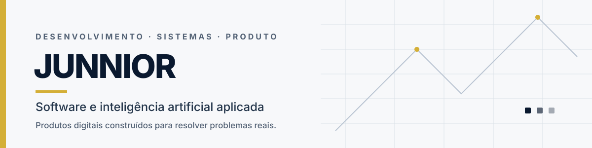

  

  <a href="https://lordjunnior.com.br/"><strong>PORTFÓLIO</strong></a>
  &nbsp; · &nbsp;
  <a href="https://github.com/lordjunnior?tab=repositories"><strong>REPOSITÓRIOS</strong></a>
  &nbsp; · &nbsp;
  <a href="https://github.com/lordjunnior/meusite"><strong>PROJETO PRINCIPAL</strong></a>

# Software, IA aplicada e produtos digitais

Sou desenvolvedor independente e trabalho na interseção entre software, inteligência artificial, automação e experiência de produto. Transformo ideias em aplicações e ferramentas digitais, acompanhando o processo da concepção à implementação e evolução.

Não me interessa tecnologia como vitrine. Interessa-me o que ela permite construir, simplificar e colocar em funcionamento.

## Projetos selecionados

<table>
  <tr>
    <td width="50%" valign="top">
      <h3><a href="https://github.com/lordjunnior/meusite">01 / Soberania Individual</a></h3>
      
Uma plataforma de conteúdo e ferramentas práticas voltada à autonomia financeira, segurança digital e preparação pessoal.

      
<strong>Foco técnico</strong> Aplicação web, arquitetura de conteúdo, experiência responsiva, recursos interativos e otimização de ativos.

      
<code>React</code> <code>TypeScript</code> <code>Vite</code> <code>Tailwind CSS</code>

      
<a href="https://lordjunnior.com.br/">Visitar projeto →</a>

    </td>
    <td width="50%" valign="top">
      <h3><a href="https://github.com/lordjunnior/PrismaEnsino">02 / Prisma Ensino</a></h3>
      
Aplicação educacional com ferramentas para apoiar professores na criação de exercícios e conteúdos personalizados, com referência à BNCC.

      
<strong>Foco técnico</strong> Interface de produto, fluxos de criação, estado da aplicação e integração com serviços de IA.

      
<code>React</code> <code>TypeScript</code> <code>Vite</code>

      
<a href="https://github.com/lordjunnior/PrismaEnsino">Explorar código →</a>

    </td>
  </tr>
  <tr>
    <td width="50%" valign="top">
      <h3><a href="https://github.com/lordjunnior/lordjunnior">03 / LordTecaRetro</a></h3>
      
Projeto de entretenimento retrô que busca tornar a experiência de acesso a jogos clássicos simples e direta pelo navegador.

      
<strong>Foco técnico</strong> Aplicação web, organização de interface, integração de serviços e metadados para compartilhamento.

      
<code>React</code> <code>TypeScript</code> <code>Vite</code> <code>Express</code> <code>Firebase</code>

      
<a href="https://lordtecaretro.vercel.app/">Visitar projeto →</a> · <a href="docs/lordtecaretro-setup.md">Executar localmente</a>

    </td>
    <td width="50%" valign="top">
      <h3>04 / Laboratório de IA local</h3>
      
Experimentação com modelos locais e ferramentas de geração e automação para desenvolver fluxos de trabalho privados e adaptáveis.

      
<strong>Foco técnico</strong> Execução local de modelos, integração de ferramentas e desenho de fluxos de produção.

      
<code>Ollama</code> <code>LM Studio</code> <code>ComfyUI</code>

      
Pesquisa e experimentação contínuas.

    </td>
  </tr>
</table>

## Stack de trabalho

<table>
  <tr>
    <td><strong>Aplicações</strong></td>
    <td>TypeScript · JavaScript · React · Vite · Node.js</td>
  </tr>
  <tr>
    <td><strong>Dados e serviços</strong></td>
    <td>Supabase · Firebase · APIs · integrações</td>
  </tr>
  <tr>
    <td><strong>IA aplicada</strong></td>
    <td>Modelos generativos · Ollama · LM Studio · ComfyUI</td>
  </tr>
  <tr>
    <td><strong>Produto e interface</strong></td>
    <td>Design de interface · prototipação · experiência do usuário</td>
  </tr>
</table>

## Como abordo um projeto

**01 — Entender o problema.** Definir a necessidade, as restrições e o resultado esperado.

**02 — Desenhar a solução.** Estruturar os fluxos, a interface e as integrações necessárias antes de adicionar complexidade.

**03 — Implementar e validar.** Construir, testar os caminhos principais e corrigir problemas observados.

**04 — Evoluir com critério.** Melhorar desempenho, acessibilidade, manutenção e clareza sem adicionar recursos só por adicionar.

## Para explorar

- [Todos os repositórios públicos](https://github.com/lordjunnior?tab=repositories)
- [Site e portfólio](https://lordjunnior.com.br/)
- [Código e documentação do projeto principal](https://github.com/lordjunnior/meusite)

---

Junnior · Software, sistemas e soluções digitais

