<!--
  Lord Junnior — desenvolvedor web, designer, educador digital, IA aplicada, Bitcoin, autocustódia,
  privacidade digital, segurança operacional, soberania individual. Santa Catarina, Brasil.
  https://lordjunnior.com.br
-->

  <a href="https://lordjunnior.com.br/">
    
  </a>

   

  

    

  
  
  
  
  

    

  

 

> **O manual que o sistema não quer que você leia.** Alfabetização monetária, autocustódia e estratégias de saída: A infraestrutura para quem decidiu parar de financiar o próprio roubo.

<table>
  <tr>
    <td width="28%" valign="top">
      
    </td>
    <td width="72%" valign="top">

## ◆ Desenvolvimento web, design de produto e IA aplicada

**Eu conecto estratégia, experiência do usuário, design e código para transformar ideias em produtos digitais funcionais.**

Sou desenvolvedor independente, designer e educador digital em Santa Catarina, Brasil. Desde 2008 trabalho com design e motion; hoje amplio essa experiência para aplicações web, automações, inteligência artificial aplicada e produtos próprios. Meu portfólio reúne produtos digitais publicados, ferramentas autorais e projetos de código aberto. A trajetória combina design, audiovisual, desenvolvimento de aplicações, automações e inteligência artificial aplicada, com foco em transformar necessidades concretas em experiências digitais funcionais.

Minha forma de trabalhar resolve um problema comum: quando estratégia, interface, desenvolvimento e publicação ficam desconectados, o produto perde clareza. Eu consigo conduzir essas etapas de forma integrada, mantendo o objetivo do projeto visível do primeiro esboço ao deploy.

**O que isso significa na prática:** menos ruído entre disciplinas, decisões de produto mais coerentes e soluções pensadas tanto para quem usa quanto para quem precisa manter e evoluir o sistema.

    </td>
  </tr>
</table>

## ◆ Projetos em destaque: produtos reais, código e execução

Estes projetos mostram diferentes capacidades: construir uma plataforma, resolver uma necessidade específica, estruturar uma experiência de usuário e levar uma aplicação até a publicação.

<table>
  <tr>
    <td width="50%" valign="top">
      
      <h3><a href="https://lordjunnior.com.br/">01 · Soberania Individual</a></h3>
      Plataforma editorial com ferramentas interativas sobre autonomia financeira, segurança digital, autocustódia e preparação pessoal. Reúne conteúdo, interface, aplicações e experiências próprias em um único produto.
      
<code>React</code> <code>TypeScript</code> <code>Vite</code> <code>Tailwind CSS</code>

      <a href="https://lordjunnior.com.br/"><b>Acessar produto →</b></a>
    </td>
    <td width="50%" valign="top">
      
      <h3><a href="https://prisma-ensino.vercel.app/">02 · Prisma Ensino</a></h3>
      Aplicação educacional voltada ao trabalho docente, com fluxos para apoiar a criação de exercícios personalizados alinhados à BNCC e a produção de materiais pedagógicos.
      
<code>React</code> <code>TypeScript</code> <code>Vite</code> <code>IA aplicada</code>

      <a href="https://prisma-ensino.vercel.app/"><b>Acessar aplicação →</b></a> · <a href="https://github.com/lordjunnior/PrismaEnsino">Ver código →</a>
    </td>
  </tr>
  <tr>
    <td width="50%" valign="top">
      <a href="https://lordtecaretro.vercel.app/">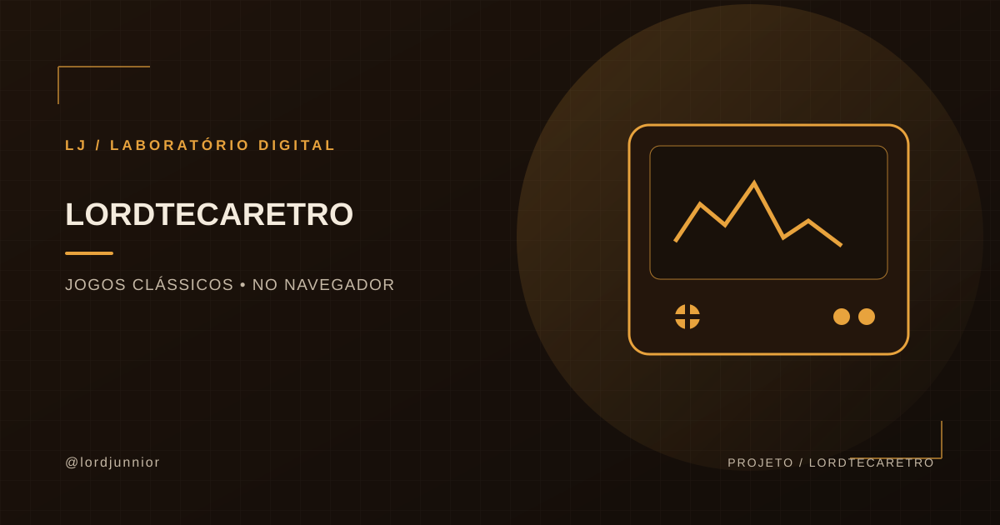</a>
      <h3><a href="https://lordtecaretro.vercel.app/">03 · LordTecaRetro</a></h3>
      <b>Um centro de entretenimento retrô gratuito, direto no navegador.</b> Reúna a nostalgia dos jogos clássicos e a praticidade de jogar sem pagar, sem anúncios e sem precisar instalar programas desconhecidos. O LordTecaRetro transforma emuladores e jogos retrô em uma experiência acessível: escolha o jogo, abra e jogue. Para quem procura emuladores online grátis, jogos clássicos no navegador e diversão sem mensalidade, a proposta é simples: voltar aos clássicos sem complicação, cobrança ou interrupções publicitárias.
      
<code>React</code> <code>TypeScript</code> <code>Vite</code> <code>Express</code> <code>Firebase</code>

      <a href="https://lordtecaretro.vercel.app/"><b>Acessar projeto →</b></a> · <a href="https://github.com/lordjunnior/lordjunnior">Ver código →</a>
    </td>
    <td width="50%" valign="top">
      <a href="https://github.com/lordjunnior/cofre-fantasma">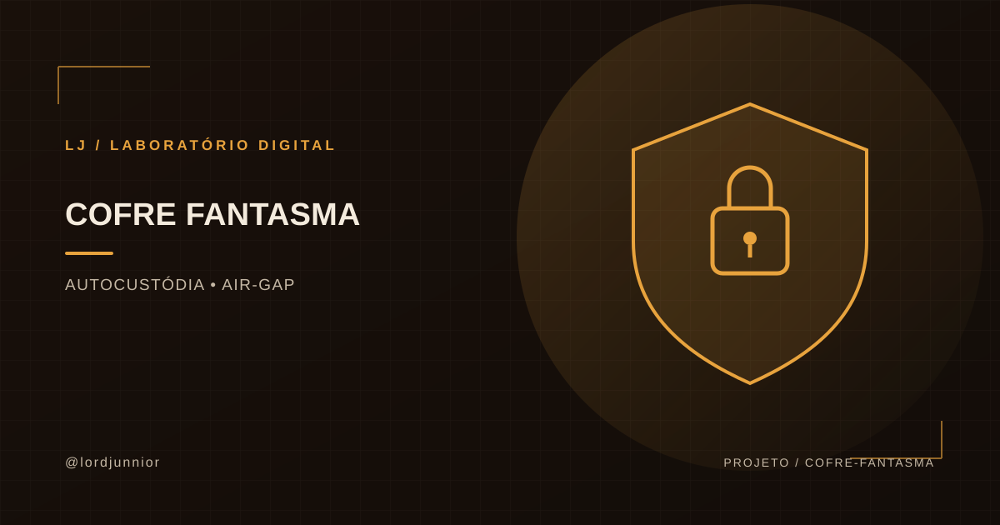</a>
      <h3><a href="https://github.com/lordjunnior/cofre-fantasma">04 · Cofre Fantasma</a></h3>
      Manual técnico para estruturar um cofre de Bitcoin isolado da internet com hardware acessível, comunicação por QR code e operação em memória volátil. Um caminho para estudar autocustódia air-gap sem depender exclusivamente de carteiras comerciais.
      
<code>Bitcoin</code> <code>Air-Gap</code> <code>Autocustódia</code> <code>Segurança</code>

      <a href="https://github.com/lordjunnior/cofre-fantasma"><b>Explorar o projeto →</b></a>
    </td>
  </tr>
  <tr>
    <td width="50%" valign="top">
      <a href="https://github.com/lordjunnior/zero-rastro">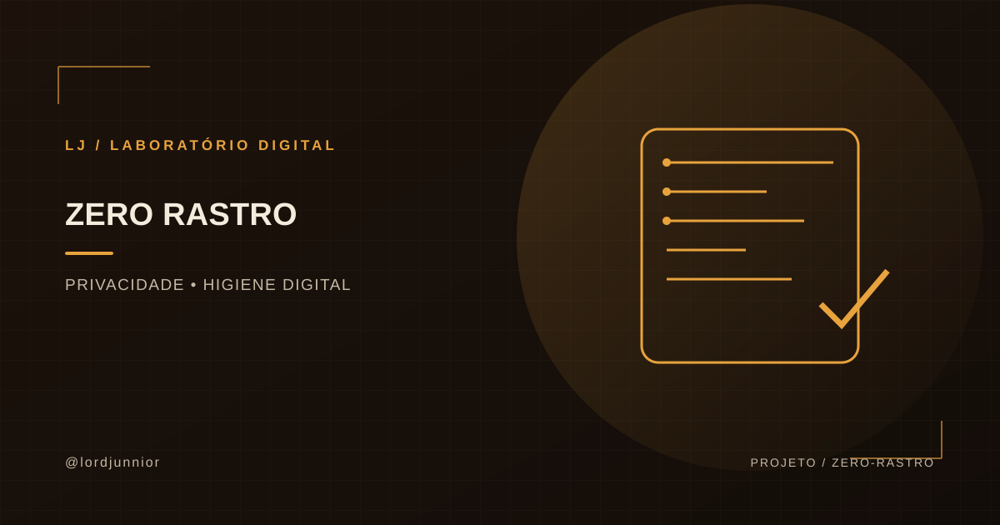</a>
      <h3><a href="https://github.com/lordjunnior/zero-rastro">05 · Zero Rastro</a></h3>
      Arsenal defensivo de privacidade digital para reduzir pegadas, metadados expostos e dependência de serviços em nuvem. Reúne procedimentos e ferramentas locais de código aberto para quem quer recuperar controle sobre os próprios dados.
      
<code>Privacidade</code> <code>Metadados</code> <code>Open Source</code> <code>Segurança digital</code>

      <a href="https://github.com/lordjunnior/zero-rastro"><b>Explorar o projeto →</b></a>
    </td>
    <td width="50%" valign="top">
      <a href="https://github.com/lordjunnior/chave-blindada">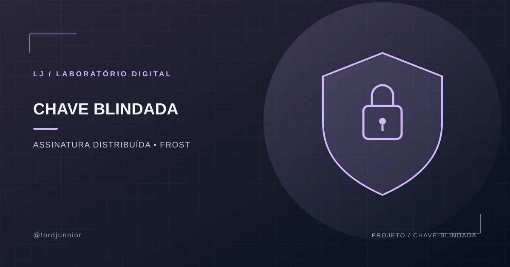</a>
      <h3><a href="https://github.com/lordjunnior/chave-blindada">06 · Chave Blindada</a></h3>
      Projeto de estudo e documentação sobre assinatura por limiar FROST, geração distribuída de chaves e regras de autorização M-de-N. A proposta é eliminar o ponto único de falha: nenhum dispositivo isolado deve concentrar todo o poder de movimentar os fundos.
      
<code>Bitcoin</code> <code>FROST</code> <code>Threshold Signatures</code> <code>Autocustódia</code>

      <a href="https://github.com/lordjunnior/chave-blindada"><b>Explorar o projeto →</b></a>
    </td>
  </tr>
  <tr>
    <td width="50%" valign="top">
      <a href="https://github.com/lordjunnior/pericia-oculta">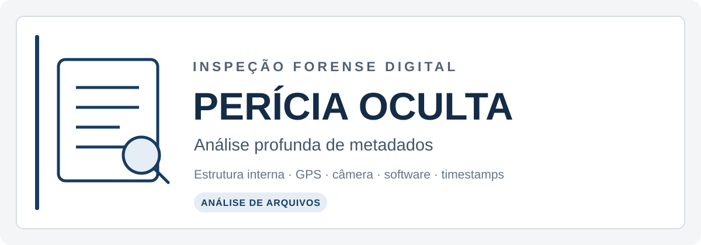</a>
      <h3><a href="https://github.com/lordjunnior/pericia-oculta">07 · Perícia Oculta</a></h3>
      Ferramenta de análise forense de metadados para investigar a estrutura interna de arquivos digitais e identificar informações que podem passar despercebidas: dados de câmera, coordenadas GPS, software utilizado e timestamps originais. Também permite purgar metadados, ajudando a compreender e controlar o que um arquivo revela sobre sua origem.
      
<code>Privacidade</code> <code>Metadados</code> <code>Análise forense</code> <code>Arquivos digitais</code>

      <a href="https://github.com/lordjunnior/pericia-oculta"><b>Explorar o projeto →</b></a>
    </td>
    <td width="50%" valign="top">
      <a href="https://github.com/lordjunnior/anula-rastro">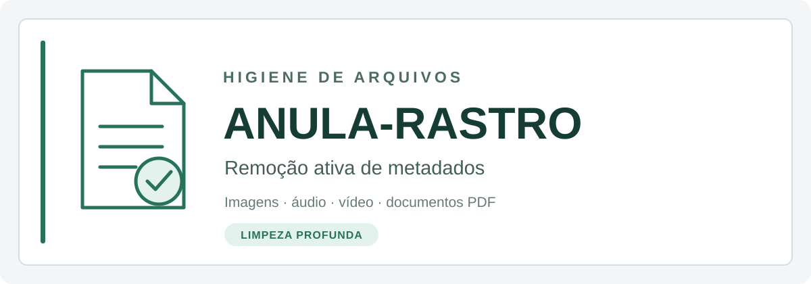</a>
      <h3><a href="https://github.com/lordjunnior/anula-rastro">08 · Anula-Rastro</a></h3>
      Ferramenta de limpeza profunda voltada à remoção ativa de metadados de imagens, áudio, vídeo e documentos PDF. Complementa a inspeção com uma etapa prática de higienização dos arquivos antes do envio ou da publicação, reduzindo a exposição de informações embutidas que podem comprometer a privacidade.
      
<code>Privacidade digital</code> <code>Limpeza de metadados</code> <code>Imagens</code> <code>Áudio e vídeo</code> <code>PDF</code>

      <a href="https://github.com/lordjunnior/anula-rastro"><b>Explorar o projeto →</b></a>
    </td>
  </tr>
</table>

## ◆ Laboratório técnico: novos repositórios

Além dos produtos em destaque, mantenho uma coleção de projetos técnicos que explora privacidade, segurança, engenharia de interfaces, agentes de IA, motion design e ferramentas de criação. A lista abaixo amplia a visão do trabalho sem confundir projetos autorais com referências e bases open source.

<table>
  <tr>
    <td width="50%" valign="top">
      <a href="https://github.com/lordjunnior/lord-escritorio-agentes">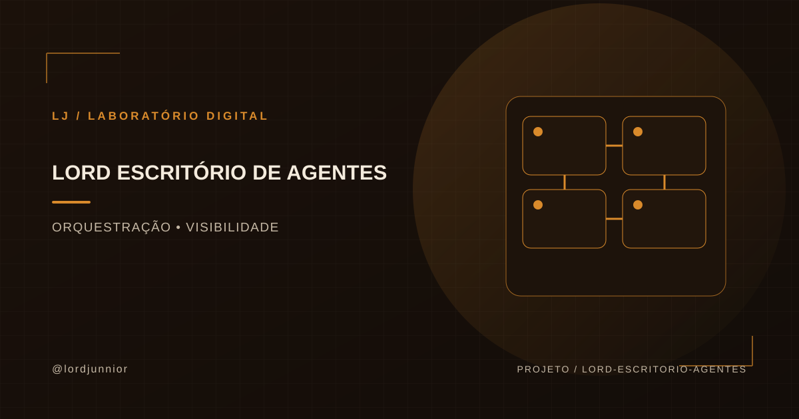</a>
      <h3><a href="https://github.com/lordjunnior/lord-escritorio-agentes">Lord Escritório de Agentes</a></h3>
      Ambiente visual para acompanhar agentes de programação em projetos distintos, com salas, personagens e indicadores de atividade. Desenvolvido para tornar o trabalho paralelo de agentes mais observável.
      
<code>TypeScript</code> <code>Node.js</code> <code>Agentes de IA</code>

    </td>
    <td width="50%" valign="top">
      
      <h3><a href="https://github.com/lordjunnior/lord-diretrizes-design">Lord Diretrizes de Design</a></h3>
      Diretrizes e competências modulares para orientar agentes de IA em tarefas de design, interface e produção digital, com instruções organizadas e reutilizáveis.
      
<code>Agent Skills</code> <code>Design systems</code> <code>Automação</code>

    </td>
  </tr>
  <tr>
    <td width="50%" valign="top">
      <a href="https://github.com/lordjunnior/lord-padroes-frontend">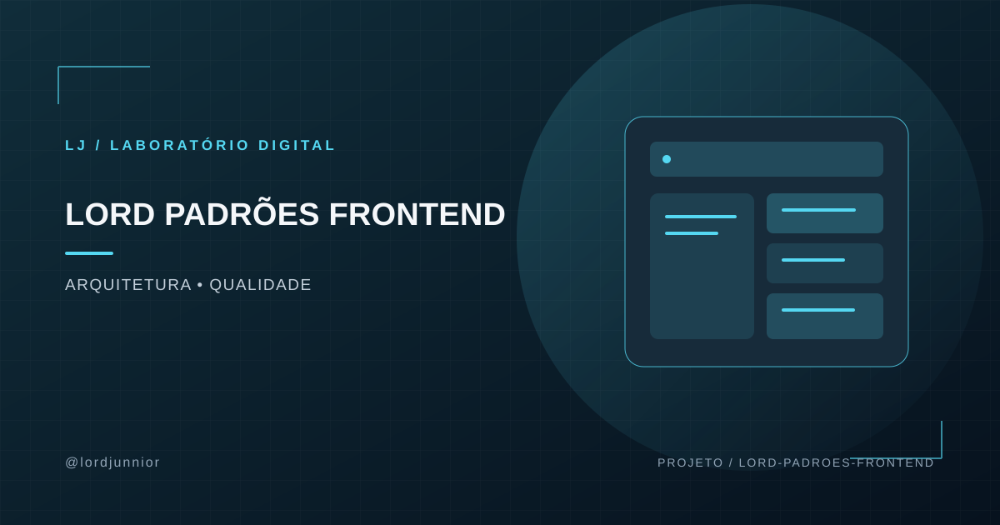</a>
      <h3><a href="https://github.com/lordjunnior/lord-padroes-frontend">Lord Padrões Frontend</a></h3>
      Referência de padrões de engenharia frontend com foco em acessibilidade, desempenho, composição de componentes e manutenção de aplicações modernas.
      
<code>React</code> <code>Vite</code> <code>WCAG</code>

    </td>
    <td width="50%" valign="top">
      <a href="https://github.com/lordjunnior/lord-habilidades-gsap">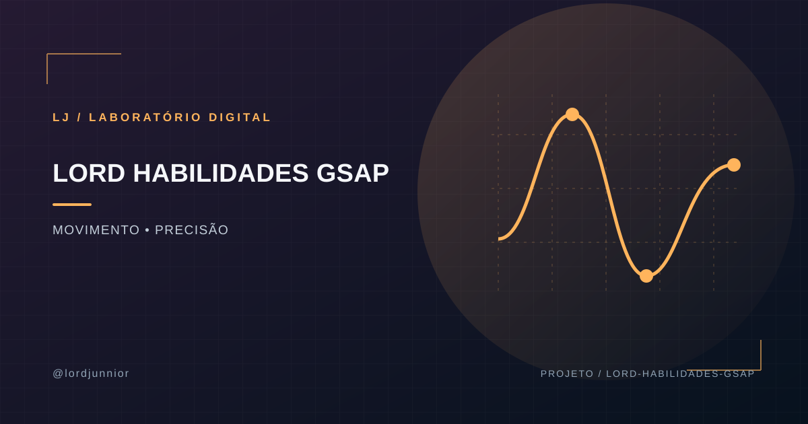</a>
      <h3><a href="https://github.com/lordjunnior/lord-habilidades-gsap">Lord Habilidades GSAP</a></h3>
      Regras e práticas para animações web com GSAP, incluindo ciclo de vida, uso de propriedades aceleradas por GPU, acessibilidade e integração com agentes de programação.
      
<code>GSAP</code> <code>React</code> <code>Motion design</code>

    </td>
  </tr>
  <tr>
    <td width="50%" valign="top">
      <a href="https://github.com/lordjunnior/lord-principios-animacao">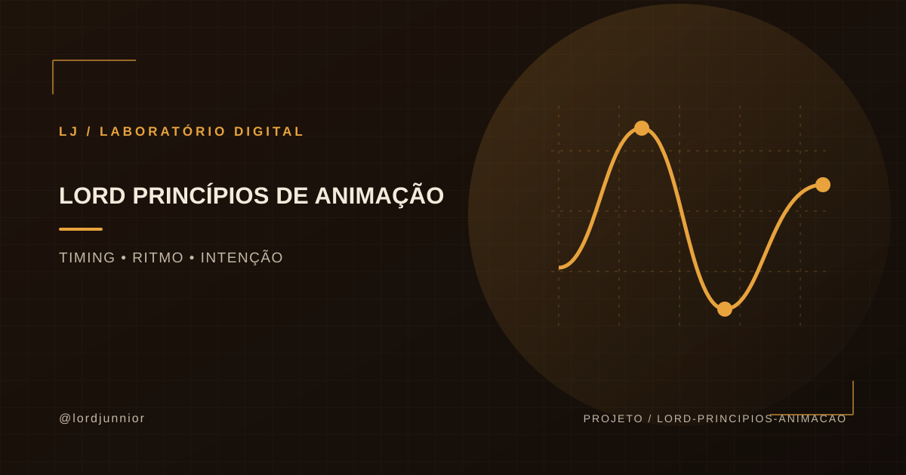</a>
      <h3><a href="https://github.com/lordjunnior/lord-principios-animacao">Lord Princípios de Animação</a></h3>
      Guia agnóstico de biblioteca para timing, easing, coreografia espacial e intenção visual, estruturado para apoiar pessoas e agentes na criação de movimento para interfaces.
      
<code>Motion design</code> <code>UI</code> <code>Agent Skills</code>

    </td>
    <td width="50%" valign="top">
      <a href="https://github.com/lordjunnior/lord-cenas-3d">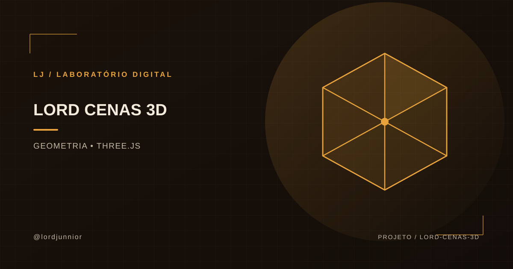</a>
      <h3><a href="https://github.com/lordjunnior/lord-cenas-3d">Lord Cenas 3D</a></h3>
      Experimentos de reconstrução procedural de objetos e cenas em Three.js a partir de referências visuais, com geometria e código preparados para exploração em tempo real.
      
<code>Three.js</code> <code>TypeScript</code> <code>3D procedural</code>

    </td>
  </tr>
  <tr>
    <td width="50%" valign="top">
      <a href="https://github.com/lordjunnior/lord-editor-video">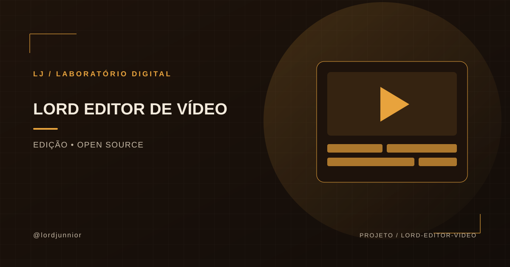</a>
      <h3><a href="https://github.com/lordjunnior/lord-editor-video">Lord Editor de Vídeo</a></h3>
      Repositório relacionado ao Concat, editor de vídeo open source. É apresentado como adaptação/curadoria de um projeto existente, não como software inteiramente criado do zero.
      
<code>Vídeo</code> <code>Open source</code> <code>Audiovisual</code>

    </td>
    <td width="50%" valign="top">
      <a href="https://github.com/lordjunnior/instagram-agent-skill">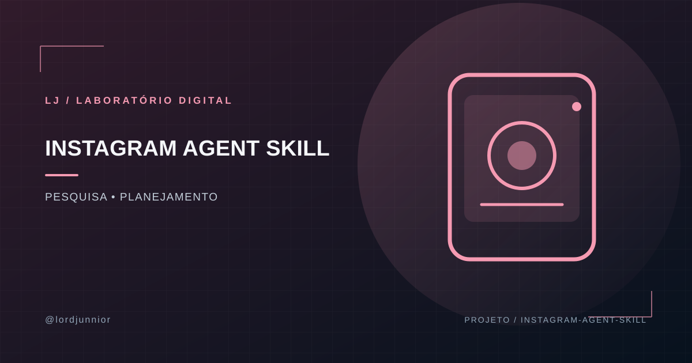</a>
      <h3><a href="https://github.com/lordjunnior/instagram-agent-skill">Instagram Agent Skill</a></h3>
      Coleção de competências open source para apoiar pesquisa, planejamento e produção de conteúdo para Instagram. Derivado de um projeto de terceiros; consulte os créditos e a licença no repositório.
      
<code>Agentes de IA</code> <code>Conteúdo</code> <code>Automação</code>

    </td>
  </tr>
  <tr>
    <td width="50%" valign="top">
      <a href="https://github.com/lordjunnior/lord-encontrador-de-chaves-btc">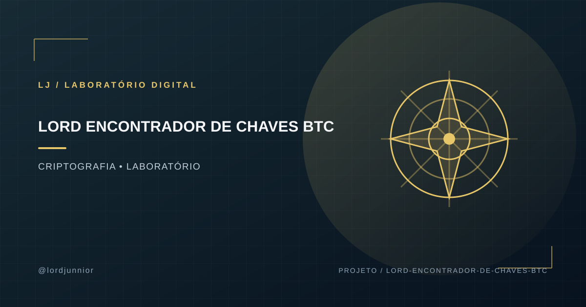</a>
      <h3><a href="https://github.com/lordjunnior/lord-encontrador-de-chaves-btc">Lord Encontrador de Chaves BTC</a></h3>
      Laboratório de estudo de computação criptográfica, paralelismo e derivação de endereços Bitcoin. O uso deve ficar restrito a testes autorizados, dados próprios e ambientes de pesquisa; não é um método prático para recuperar carteiras de terceiros.
      
<code>Node.js</code> <code>Worker Threads</code> <code>Criptografia</code>

    </td>
    <td width="50%" valign="top">
      <a href="https://github.com/lordjunnior/lord-cacachaves">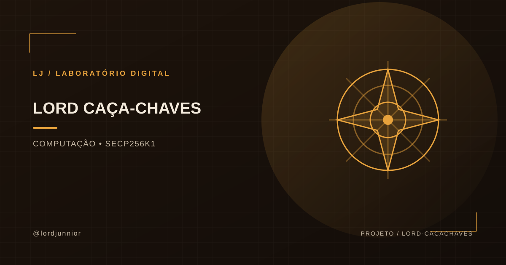</a>
      <h3><a href="https://github.com/lordjunnior/lord-cacachaves">Lord Caça-Chaves</a> · <a href="https://github.com/lordjunnior/lord-rastreador-btc">Lord Rastreador BTC</a></h3>
      Experimentos de desempenho em C e Go com computação de curvas elípticas e processamento concorrente. Projetos de laboratório para análise técnica, não promessas de encontrar fundos ou quebrar a segurança do Bitcoin.
      
<code>C</code> <code>Go</code> <code>secp256k1</code>

    </td>
  </tr>
</table>

  
  
  

### Referências open source e estudos técnicos

Também mantenho cópias de trabalho e estudos de bases abertas como [Privacy Guides](https://github.com/lordjunnior/privacyguides.org), [Krux](https://github.com/lordjunnior/krux) e outros projetos. Esses repositórios não são apresentados como criações originais: consulte os históricos, autores upstream e licenças antes de atribuir autoria ou redistribuir alterações.

- **[Anula-Rastro](https://github.com/lordjunnior/anula-rastro)** — documentação de limpeza local de metadados por reconstrução de arquivos.
- **[Perícia Oculta](https://github.com/lordjunnior/pericia-oculta)** — guias de inspeção forense de metadados e auditoria de arquivos digitais.
- **[Zero Rastro](https://github.com/lordjunnior/zero-rastro)** — materiais e ferramentas voltados à privacidade digital.
- **[Cofre Fantasma](https://github.com/lordjunnior/cofre-fantasma)** — documentação de arquitetura air-gap para estudo de autocustódia.
- **[Chave Blindada](https://github.com/lordjunnior/chave-blindada)** — estudo de assinatura por limiar e modelos de autorização distribuída.
- **[Lord Encontrador de Chaves BTC](https://github.com/lordjunnior/lord-encontrador-de-chaves-btc)**, **[Lord Caça-Chaves](https://github.com/lordjunnior/lord-cacachaves)** e **[Lord Rastreador BTC](https://github.com/lordjunnior/lord-rastreador-btc)** — estudos de algoritmos, processamento concorrente e criptografia aplicados ao ecossistema Bitcoin.

> **Transparência:** este perfil reúne produtos publicados, ferramentas autorais, documentação, laboratórios experimentais e estudos de projetos open source. Cada repositório tem seu próprio escopo, estágio e licença; a descrição individual é a referência para entender o que está implementado.

## ◆ Ferramentas autorais: transformar problemas em soluções utilizáveis

Além dos projetos de maior escopo, desenvolvo utilitários, simuladores, calculadoras e experiências interativas no meu site. Eles mostram outra parte do meu trabalho: decompor uma necessidade em regras claras, construir uma interface objetiva e entregar algo que as pessoas possam usar.

<table>
  <tr>
    <td width="50%" valign="top">
      <a href="https://lordjunnior.com.br/ferramentas">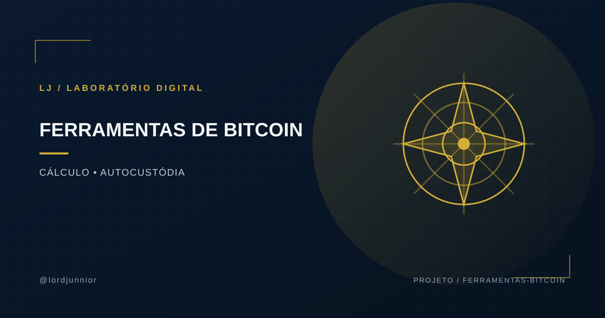</a>
      <h3><a href="https://lordjunnior.com.br/ferramentas">Bitcoin, autocustódia e soberania financeira</a></h3>

- **Gerador de Entropia BIP-39:** geração local de mnemônicos com aleatoriedade criptográfica do navegador, lista oficial e validação de checksum.
- **Herança Programada:** simulação de herança Bitcoin com bloqueio de tempo.
- **Canal Relâmpago:** visualização de liquidez em canais Lightning.
- **Bitcoin vs. Imóveis:** simulador comparativo de valorização.
- **O Último Bloco:** visualização da dinâmica de oferta do Bitcoin.
- **SaveSat — Guardião dos Satoshis:** ferramenta para analisar custos de saque.
- **Lucro do Bitcoin — Mapa da Alforria:** simulador de preço médio e retorno.

<a href="https://lordjunnior.com.br/ferramentas"><b>Explorar ferramentas →</b></a>

    </td>
    <td width="50%" valign="top">
      
      <h3><a href="https://lordjunnior.com.br/ferramentas">Utilitários, análise e experimentação</a></h3>

- **Forja de Identidade Nostr:** chaves de identidade geradas no próprio aparelho.
- **Cofre Diceware:** senhas fortes por sorteio de palavras.
- **Calculadora Taxa de Fuga:** estimativa de custos de mudança internacional.
- **Tradutor de Novilíngua:** dicionário satírico interativo.
- **HoraJusta:** registro de jornada e cálculo de horas.
- **VerificaBR:** conceito de análise de dados públicos, identificado como projeto em teste.
- **Amigo CLT:** calculadora de salário líquido, em desenvolvimento.

<a href="https://lordjunnior.com.br/ferramentas"><b>Ver o catálogo completo →</b></a>

    </td>
  </tr>
</table>

## ◆ O que posso construir

| Área | Aplicação prática |
|---|---|
| **Desenvolvimento web** | Sites, landing pages, interfaces responsivas e aplicações em React, TypeScript e Vite. |
| **Produto e experiência do usuário** | Arquitetura de informação, fluxos, hierarquia visual e interfaces que tornam tarefas mais simples. |
| **Automação e integrações** | Conexão entre serviços, redução de tarefas repetitivas e fluxos de trabalho mais eficientes. |
| **Inteligência artificial aplicada** | Integração de modelos a experiências e ferramentas; experimentação com fluxos locais e automações. |
| **Design gráfico e direção de arte** | Identidade visual, sistemas gráficos, comunicação digital e peças com propósito claro. |
| **Motion design e audiovisual** | Animação, edição e conteúdo visual pensado para comunicar e reter atenção. |
| **3D e interfaces cinéticas** | Cenas em Three.js, animações com GSAP e efeitos acelerados por GPU. |
| **Conteúdo e educação digital** | Materiais didáticos e experiências que transformam assuntos complexos em orientação acessível. |

Não trato essas áreas como serviços isolados. O diferencial está em conectá-las quando o projeto exige: a estratégia orienta a experiência, o design melhora a compreensão, o código dá forma à solução e a publicação coloca o produto diante de quem precisa dele.

## ◆ Como trabalho: da ideia ao deploy

<table>
  <tr>
    <td width="25%" valign="top" align="center"><h3>01</h3><b>Diagnóstico</b> Entendo o objetivo, o público, as restrições e o que precisa mudar para o projeto dar certo.</td>
    <td width="25%" valign="top" align="center"><h3>02</h3><b>Experiência</b> Organizo conteúdo, fluxos e interface antes de adicionar complexidade desnecessária.</td>
    <td width="25%" valign="top" align="center"><h3>03</h3><b>Implementação</b> Desenvolvo a solução, conecto os serviços necessários e valido os caminhos principais.</td>
    <td width="25%" valign="top" align="center"><h3>04</h3><b>Publicação e evolução</b> Levo o produto ao ar e identifico melhorias de clareza, manutenção e confiabilidade.</td>
  </tr>
</table>

## ◆ Stack e ferramentas

  
    
  

 

**Front-end:** `TypeScript` · `JavaScript` · `React` · `Vite` · `Tailwind CSS` · `GSAP` · `Three.js`  
**Back-end e dados:** `Node.js` · `Express` · `Supabase` · `Firebase`  
**IA e automação:** `Ollama` · `LM Studio` · `ComfyUI` · integrações com modelos  
**Design e audiovisual:** Photoshop · CorelDRAW · Figma · Canva · motion design · edição de vídeo

  
<strong>▸ Outros projetos, protótipos e laboratório digital</strong>

   

  - **Monkey:** conceito de marketplace para comercialização de produtos e conteúdos digitais. Repositório privado.
  - **Criativos Infinitos:** ferramenta de criação de conteúdo para influenciadores. Repositório privado.
  - **LordHub:** projeto de jogos acessíveis pelo navegador. Repositório privado.
  - **JARVIS-ChatGPT:** estudo baseado em projeto open source de assistente conversacional por voz; não apresentado como criação original.
  - **Polymarket Agents:** repositório derivado de projeto open source; separado dos trabalhos autorais.
  - **IA local:** experimentos com modelos locais e fluxos de geração e automação.

  Tenho projetos em diferentes estágios de maturidade. Quando algo é protótipo, estudo ou repositório privado, deixo isso claro: prefiro mostrar o estágio real de cada trabalho a confundir experimentação com produto final.

## ◆ Por que trabalhar comigo

- **Visão integrada:** consigo transitar entre estratégia, design, implementação e comunicação sem perder o objetivo do produto.
- **Experiência visual aplicada:** mais de 17 anos de design e motion ajudam a construir interfaces e materiais com hierarquia, consistência e intenção.
- **Execução prática:** não fico apenas na ideia ou no layout; trabalho para transformar conceitos em soluções funcionais.
- **Autonomia e adaptação:** escolho ferramentas de acordo com o problema, não o contrário.
- **Comunicação clara:** procuro tornar decisões técnicas compreensíveis para quem precisa aprovar, usar ou manter a solução.

## ◆ Vamos transformar uma ideia em produto?

Se você procura alguém que entenda tanto a experiência quanto a implementação, explore os projetos acima e avalie o trabalho pelo que está construído. Posso contribuir em desenvolvimento web, design de produto, automação, IA aplicada, direção de arte e conteúdo digital.

  
  
  

⚡ <b>Apoio via Lightning</b> · <code>securecorn53@walletofsatoshi.com</code>

Lord Junnior · Desenvolvedor web · Designer gráfico e motion · IA aplicada · Automação · Santa Catarina, Brasil

