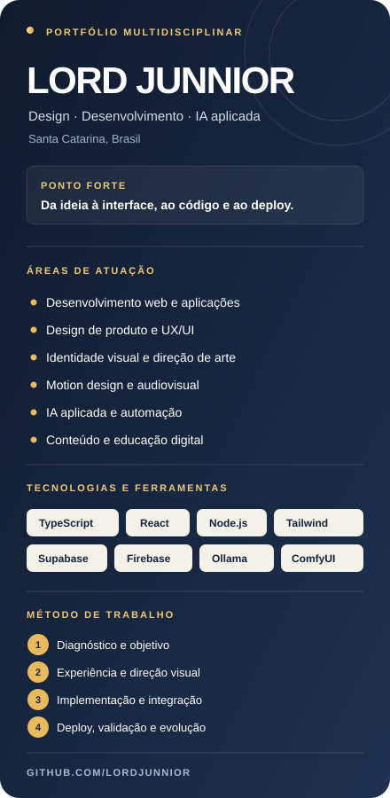

  

  

  <a href="https://lordjunnior.com.br/"><strong>PORTFÓLIO</strong></a>
  &nbsp; · &nbsp;
  <a href="https://github.com/lordjunnior?tab=repositories"><strong>EXPLORAR REPOSITÓRIOS</strong></a>
  &nbsp; · &nbsp;
  <a href="https://lordjunnior.com.br/ferramentas"><strong>FERRAMENTAS AUTORAIS</strong></a>
  &nbsp; · &nbsp;
  <a href="https://lordjunnior.com.br/"><strong>CONTATO</strong></a>

<table>
  <tr>
    <td width="28%" valign="top">
      
    </td>
    <td width="72%" valign="top">

# Desenvolvimento web, design de produto e IA aplicada

**Eu conecto estratégia, experiência do usuário, design e código para transformar ideias em produtos digitais funcionais.**

Sou desenvolvedor independente, designer e educador digital em Santa Catarina, Brasil. Desde 2008 trabalho com design e motion; hoje amplio essa experiência para aplicações web, automações, inteligência artificial aplicada e produtos próprios. Meu portfólio reúne produtos digitais publicados, ferramentas autorais e projetos de código aberto. A trajetória combina design, audiovisual, desenvolvimento de aplicações, automações e inteligência artificial aplicada, com foco em transformar necessidades concretas em experiências digitais funcionais.

Minha forma de trabalhar resolve um problema comum: quando estratégia, interface, desenvolvimento e publicação ficam desconectados, o produto perde clareza. Eu consigo conduzir essas etapas de forma integrada, mantendo o objetivo do projeto visível do primeiro esboço ao deploy.

**O que isso significa na prática:** menos ruído entre disciplinas, decisões de produto mais coerentes e soluções pensadas tanto para quem usa quanto para quem precisa manter e evoluir o sistema.

    </td>
  </tr>
</table>

---

## Projetos em destaque: produtos reais, código e execução

Estes projetos mostram diferentes capacidades: construir uma plataforma, resolver uma necessidade específica, estruturar uma experiência de usuário e levar uma aplicação até a publicação.

<table>
  <tr>
    <td width="50%" valign="top">
      <a href="https://lordjunnior.com.br/">
        <rect width='1200' height='630' fill='%230a0e17'/><rect x='40' y='40' width='1120' height='550' rx='12' fill='%23111827' stroke='%231f2937' stroke-width='2'/><text x='80' y='120' fill='%2338bdf8' font-family='monospace' font-size='18' letter-spacing='3'>PLATAFORMA EDITORIAL</text><text x='80' y='210' fill='%23f8fafc' font-family='sans-serif' font-weight='bold' font-size='50'>Soberania Individual</text><text x='80' y='270' fill='%2394a3b8' font-family='sans-serif' font-size='22'>Autonomia financeira, autocustódia e privacidade</text><g transform='translate(80, 360)'><rect width='160' height='40' rx='6' fill='%230284c7'/><text x='80' y='25' fill='%23ffffff' font-family='sans-serif' font-weight='bold' font-size='16' text-anchor='middle'>PLATAFORMA</text></g><g transform='translate(880, 190)'><circle cx='80' cy='80' r='70' fill='%230f172a' stroke='%2338bdf8' stroke-width='4'/><path d='M80 30 L80 130 M30 80 L130 80' stroke='%2338bdf8' stroke-width='4'/><circle cx='80' cy='80' r='30' fill='none' stroke='%2338bdf8' stroke-width='4'/></g></svg>" alt="Soberania Individual" width="100%" />
      </a>
      <h3><a href="https://lordjunnior.com.br/">01 · Soberania Individual</a></h3>
      Plataforma editorial com ferramentas interativas sobre autonomia financeira, segurança digital, autocustódia e preparação pessoal. Reúne conteúdo, interface, aplicações e experiências próprias em um único produto.
      
<code>React</code> <code>TypeScript</code> <code>Vite</code> <code>Tailwind CSS</code>

      <a href="https://lordjunnior.com.br/">Acessar produto →</a> · <a href="https://github.com/lordjunnior/meusite">Ver código →</a>
    </td>
    <td width="50%" valign="top">
      <a href="https://prisma-ensino.vercel.app/">
        <rect width='1200' height='630' fill='%230a0e17'/><rect x='40' y='40' width='1120' height='550' rx='12' fill='%23111827' stroke='%231f2937' stroke-width='2'/><text x='80' y='120' fill='%2310b981' font-family='monospace' font-size='18' letter-spacing='3'>SUPORTE PEDAGÓGICO</text><text x='80' y='210' fill='%23f8fafc' font-family='sans-serif' font-weight='bold' font-size='50'>Prisma Ensino</text><text x='80' y='270' fill='%2394a3b8' font-family='sans-serif' font-size='22'>Criação de atividades e IA aplicada à educação</text><g transform='translate(80, 360)'><rect width='160' height='40' rx='6' fill='%23059669'/><text x='80' y='25' fill='%23ffffff' font-family='sans-serif' font-weight='bold' font-size='16' text-anchor='middle'>EDTECH</text></g><g transform='translate(880, 190)'><rect x='20' y='30' width='120' height='100' rx='8' fill='%230f172a' stroke='%2310b981' stroke-width='3'/><line x1='40' y1='60' x2='120' y2='60' stroke='%2310b981' stroke-width='4' stroke-linecap='round'/><line x1='40' y1='90' x2='100' y2='90' stroke='%2310b981' stroke-width='4' stroke-linecap='round'/></g></svg>" alt="Prisma Ensino" width="100%" />
      </a>
      <h3><a href="https://prisma-ensino.vercel.app/">02 · Prisma Ensino</a></h3>
      Aplicação educacional voltada ao trabalho docente, com fluxos para apoiar a criação de exercícios personalizados alinhados à BNCC e a produção de materiais pedagógicos.
      
<code>React</code> <code>TypeScript</code> <code>Vite</code> <code>IA aplicada</code>

      <a href="https://prisma-ensino.vercel.app/">Acessar aplicação →</a> · <a href="https://github.com/lordjunnior/PrismaEnsino">Ver código →</a>
    </td>
  </tr>
  <tr>
    <td width="50%" valign="top">
      <a href="https://lordtecaretro.vercel.app/">
        <rect width='1200' height='630' fill='%230a0e17'/><rect x='40' y='40' width='1120' height='550' rx='12' fill='%23111827' stroke='%231f2937' stroke-width='2'/><text x='80' y='120' fill='%2338bdf8' font-family='monospace' font-size='18' letter-spacing='3'>ARCADE / WEB</text><text x='80' y='210' fill='%23f8fafc' font-family='sans-serif' font-weight='bold' font-size='50'>LordTecaRetro</text><text x='80' y='270' fill='%2394a3b8' font-family='sans-serif' font-size='22'>Centro de entretenimento retrô e emulação web</text><g transform='translate(80, 360)'><rect width='160' height='40' rx='6' fill='%230284c7'/><text x='80' y='25' fill='%23ffffff' font-family='sans-serif' font-weight='bold' font-size='16' text-anchor='middle'>RETRO GAMING</text></g><g transform='translate(850, 180)'><circle cx='120' cy='120' r='100' fill='%230f172a' stroke='%2338bdf8' stroke-width='4'/><path d='M90 120 L150 120 M120 90 L120 150' stroke='%2338bdf8' stroke-width='8' stroke-linecap='round'/><circle cx='200' cy='80' r='12' fill='%23f59e0b'/><circle cx='230' cy='120' r='12' fill='%23ef4444'/></g></svg>" alt="LordTecaRetro" width="100%" />
      </a>
      <h3><a href="https://lordtecaretro.vercel.app/">03 · LordTecaRetro</a></h3>
      **Um centro de entretenimento retrô gratuito, direto no navegador.** Reúne a nostalgia dos jogos clássicos e a praticidade de jogar sem pagar, sem anúncios e sem precisar instalar programas desconhecidos. O LordTecaRetro transforma emuladores e jogos retrô em uma experiência acessível: escolha o jogo, abra e jogue. Para quem procura emuladores online grátis, jogos clássicos no navegador e diversão sem mensalidade, a proposta é simples: voltar aos clássicos sem complicação, cobrança ou interrupções publicitárias.
      
<code>React</code> <code>TypeScript</code> <code>Vite</code> <code>Express</code> <code>Firebase</code>

      <a href="https://lordtecaretro.vercel.app/">Acessar projeto →</a> · <a href="https://github.com/lordjunnior/LordTecaRetro">Ver código →</a>
    </td>
    <td width="50%" valign="top">
      <a href="https://github.com/lordjunnior/cofre-fantasma">
        <rect width='1200' height='630' fill='%230a0e17'/><rect x='40' y='40' width='1120' height='550' rx='12' fill='%23111827' stroke='%231f2937' stroke-width='2'/><text x='80' y='120' fill='%23f59e0b' font-family='monospace' font-size='18' letter-spacing='3'>AUTOCUSTÓDIA · AIR-GAP</text><text x='80' y='210' fill='%23f8fafc' font-family='sans-serif' font-weight='bold' font-size='50'>Cofre Fantasma</text><text x='80' y='270' fill='%2394a3b8' font-family='sans-serif' font-size='22'>Isolamento físico e comunicação por QR Code</text><g transform='translate(80, 360)'><rect width='180' height='40' rx='6' fill='%23b45309'/><text x='90' y='25' fill='%23ffffff' font-family='sans-serif' font-weight='bold' font-size='16' text-anchor='middle'>OFFLINE SECURE</text></g><g transform='translate(880, 190)'><rect x='0' y='0' width='160' height='160' rx='12' fill='%230f172a' stroke='%23f59e0b' stroke-width='3'/><rect x='25' y='25' width='35' height='35' fill='%23f59e0b'/><rect x='100' y='25' width='35' height='35' fill='%23f59e0b'/><rect x='25' y='100' width='35' height='35' fill='%23f59e0b'/><circle cx='118' cy='118' r='18' fill='%23f59e0b'/></g></svg>" alt="Cofre Fantasma" width="100%" />
      </a>
      <h3><a href="https://github.com/lordjunnior/cofre-fantasma">04 · Cofre Fantasma</a></h3>
      Manual técnico para estruturar um cofre de Bitcoin isolado da internet com hardware acessível, comunicação por QR code e operação em memória volátil. Um caminho para estudar autocustódia air-gap sem depender exclusivamente de carteiras comerciais.
      
<code>Bitcoin</code> <code>Air-Gap</code> <code>Autocustódia</code> <code>Segurança</code>

      <a href="https://github.com/lordjunnior/cofre-fantasma">Explorar o projeto →</a>
    </td>
  </tr>
  <tr>
    <td width="50%" valign="top">
      <a href="https://github.com/lordjunnior/zero-rastro">
        <rect width='1200' height='630' fill='%230a0e17'/><rect x='40' y='40' width='1120' height='550' rx='12' fill='%23111827' stroke='%231f2937' stroke-width='2'/><text x='80' y='120' fill='%2310b981' font-family='monospace' font-size='18' letter-spacing='3'>ARSENAL DEFENSIVO</text><text x='80' y='210' fill='%23f8fafc' font-family='sans-serif' font-weight='bold' font-size='50'>Zero Rastro</text><text x='80' y='270' fill='%2394a3b8' font-family='sans-serif' font-size='22'>Privacidade digital e higiene de metadados</text><g transform='translate(80, 360)'><rect width='160' height='40' rx='6' fill='%23047857'/><text x='80' y='25' fill='%23ffffff' font-family='sans-serif' font-weight='bold' font-size='16' text-anchor='middle'>LOCAL &amp; OPEN</text></g><g transform='translate(880, 190)'><circle cx='80' cy='80' r='75' fill='%230f172a' stroke='%2310b981' stroke-width='4'/><path d='M50 80 L70 100 L115 55' stroke='%2310b981' stroke-width='8' stroke-linecap='round' stroke-linejoin='round' fill='none'/></g></svg>" alt="Zero Rastro" width="100%" />
      </a>
      <h3><a href="https://github.com/lordjunnior/zero-rastro">05 · Zero Rastro</a></h3>
      Arsenal defensivo de privacidade digital para reduzir pegadas, metadados expostos e dependência de serviços em nuvem. Reúne procedimentos e ferramentas locais de código aberto para quem quer recuperar controle sobre os próprios dados.
      
<code>Privacidade</code> <code>Metadados</code> <code>Open Source</code> <code>Segurança digital</code>

      <a href="https://github.com/lordjunnior/zero-rastro">Explorar o projeto →</a>
    </td>
    <td width="50%" valign="top">
      <a href="https://github.com/lordjunnior/chave-blindada">
        <rect width='1200' height='630' fill='%230a0e17'/><rect x='40' y='40' width='1120' height='550' rx='12' fill='%23111827' stroke='%231f2937' stroke-width='2'/><text x='80' y='120' fill='%236366f1' font-family='monospace' font-size='18' letter-spacing='3'>CRIPTOGRAFIA · FROST</text><text x='80' y='210' fill='%23f8fafc' font-family='sans-serif' font-weight='bold' font-size='50'>Chave Blindada</text><text x='80' y='270' fill='%2394a3b8' font-family='sans-serif' font-size='22'>Assinatura por limiar e eliminação de ponto único</text><g transform='translate(80, 360)'><rect width='160' height='40' rx='6' fill='%234f46e5'/><text x='80' y='25' fill='%23ffffff' font-family='sans-serif' font-weight='bold' font-size='16' text-anchor='middle'>THRESHOLD</text></g><g transform='translate(880, 190)'><rect x='30' y='30' width='100' height='100' rx='16' fill='%230f172a' stroke='%236366f1' stroke-width='4'/><circle cx='80' cy='80' r='24' fill='%236366f1'/></g></svg>" alt="Chave Blindada" width="100%" />
      </a>
      <h3><a href="https://github.com/lordjunnior/chave-blindada">06 · Chave Blindada</a></h3>
      Projeto de estudo e documentação sobre assinatura por limiar FROST, geração distribuída de chaves e regras de autorização M-de-N. A proposta é eliminar o ponto único de falha: nenhum dispositivo isolado deve concentrar todo o poder de movimentar os fundos.
      
<code>Bitcoin</code> <code>FROST</code> <code>Threshold Signatures</code> <code>Autocustódia</code>

      <a href="https://github.com/lordjunnior/chave-blindada">Explorar o projeto →</a>
    </td>
  </tr>
  <tr>
    <td width="50%" valign="top">
      
      <h3><a href="https://github.com/lordjunnior/pericia-oculta">07 · Perícia Oculta</a></h3>
      Ferramenta de análise forense de metadados para investigar a estrutura interna de arquivos digitais e identificar informações que podem passar despercebidas: dados de câmera, coordenadas GPS, software utilizado e timestamps originais. Também permite purgar metadados, ajudando a compreender e controlar o que um arquivo revela sobre sua origem.
      
<code>Privacidade</code> <code>Metadados</code> <code>Análise forense</code> <code>Arquivos digitais</code>

      <a href="https://github.com/lordjunnior/pericia-oculta">Explorar o projeto →</a>
    </td>
    <td width="50%" valign="top">
      
      <h3><a href="https://github.com/lordjunnior/anula-rastro">08 · Anula-Rastro</a></h3>
      Ferramenta de limpeza profunda voltada à remoção ativa de metadados de imagens, áudio, vídeo e documentos PDF. Complementa a inspeção com uma etapa prática de higienização dos arquivos antes do envio ou da publicação, reduzindo a exposição de informações embutidas que podem comprometer a privacidade.
      
<code>Privacidade digital</code> <code>Limpeza de metadados</code> <code>Imagens</code> <code>Áudio e vídeo</code> <code>PDF</code>

      <a href="https://github.com/lordjunnior/anula-rastro">Explorar o projeto →</a>
    </td>
  </tr>
</table>

## Ferramentas autorais: transformar problemas em soluções utilizáveis

Além dos projetos de maior escopo, desenvolvo utilitários, simuladores, calculadoras e experiências interativas no meu site. Eles mostram outra parte do meu trabalho: decompor uma necessidade em regras claras, construir uma interface objetiva e entregar algo que as pessoas possam usar.

<table>
  <tr>
    <td width="50%" valign="top">
      <h3><a href="https://lordjunnior.com.br/ferramentas">Bitcoin, autocustódia e soberania financeira</a></h3>
      - **Gerador de Entropia BIP-39:** geração local de mnemônicos com aleatoriedade criptográfica do navegador, lista oficial e validação de checksum.
      - **Bitcoin vs. Imóveis:** simulador comparativo de valorização.
      - **O Último Bloco:** visualização da dinâmica de oferta do Bitcoin.
      - **SaveSat — Guardião dos Satoshis:** ferramenta para analisar custos de saque.
      - **Lucro do Bitcoin — Mapa da Alforria:** simulador de preço médio e retorno.
      
<a href="https://lordjunnior.com.br/ferramentas">Explorar ferramentas →</a>

    </td>
    <td width="50%" valign="top">
      <h3><a href="https://lordjunnior.com.br/ferramentas">Utilitários, análise e experimentação</a></h3>
      - **Calculadora Taxa de Fuga:** estimativa de custos de mudança internacional.
      - **Tradutor de Novilíngua:** dicionário satírico interativo.
      - **HoraJusta:** registro de jornada e cálculo de horas.
      - **VerificaBR:** conceito de análise de dados públicos, identificado como projeto em teste.
      - **Amigo CLT:** calculadora de salário líquido, em desenvolvimento.
      
<a href="https://lordjunnior.com.br/ferramentas">Ver o catálogo completo →</a>

    </td>
  </tr>
</table>

---

## O que posso construir

| Área | Aplicação prática |
|---|---|
| **Desenvolvimento web** | Sites, landing pages, interfaces responsivas e aplicações em React, TypeScript e Vite. |
| **Produto e experiência do usuário** | Arquitetura de informação, fluxos, hierarquia visual e interfaces que tornam tarefas mais simples. |
| **Automação e integrações** | Conexão entre serviços, redução de tarefas repetitivas e fluxos de trabalho mais eficientes. |
| **Inteligência artificial aplicada** | Integração de modelos a experiências e ferramentas; experimentação com fluxos locais e automações. |
| **Design gráfico e direção de arte** | Identidade visual, sistemas gráficos, comunicação digital e peças com propósito claro. |
| **Motion design e audiovisual** | Animação, edição e conteúdo visual pensado para comunicar e reter atenção. |
| **Conteúdo e educação digital** | Materiais didáticos e experiências que transformam assuntos complexos em orientação acessível. |

Não trato essas áreas como serviços isolados. O diferencial está em conectá-las quando o projeto exige: a estratégia orienta a experiência, o design melhora a compreensão, o código dá forma à solução e a publicação coloca o produto diante de quem precisa dele.

## Como trabalho: da ideia ao deploy

<table>
  <tr>
    <td width="25%" valign="top"><strong>01 · Diagnóstico</strong> Entendo o objetivo, o público, as restrições e o que precisa mudar para o projeto dar certo.</td>
    <td width="25%" valign="top"><strong>02 · Experiência</strong> Organizo conteúdo, fluxos e interface antes de adicionar complexidade desnecessária.</td>
    <td width="25%" valign="top"><strong>03 · Implementação</strong> Desenvolvo a solução, conecto os serviços necessários e valido os caminhos principais.</td>
    <td width="25%" valign="top"><strong>04 · Publicação e evolução</strong> Levo o produto ao ar e identifico melhorias de clareza, manutenção e confiabilidade.</td>
  </tr>
</table>

## Stack e ferramentas

**Front-end:** `TypeScript` · `JavaScript` · `React` · `Vite` · `Tailwind CSS`  
**Back-end e dados:** `Node.js` · `Express` · `Supabase` · `Firebase`  
**IA e automação:** `Ollama` · `LM Studio` · `ComfyUI` · integrações com modelos  
**Design e audiovisual:** Photoshop · CorelDRAW · Figma · Canva · motion design · edição de vídeo

  
<strong>Outros projetos, protótipos e laboratório digital</strong>

  - **Monkey:** conceito de marketplace para comercialização de produtos e conteúdos digitais. Repositório privado.
  - **Criativos Infinitos:** ferramenta de criação de conteúdo para influenciadores. Repositório privado.
  - **LordHub:** projeto de jogos acessíveis pelo navegador. Repositório privado.
  - **JARVIS-ChatGPT:** estudo baseado em projeto open source de assistente conversacional por voz; não apresentado como criação original.
  - **Polymarket Agents:** repositório derivado de projeto open source; separado dos trabalhos autorais.
  - **IA local:** experimentos com modelos locais e fluxos de geração e automação.

  Tenho projetos em diferentes estágios de maturidade. Quando algo é protótipo, estudo ou repositório privado, deixo isso claro: prefiro mostrar o estágio real de cada trabalho a confundir experimentação com produto final.

## Por que trabalhar comigo

- **Visão integrada:** consigo transitar entre estratégia, design, implementação e comunicação sem perder o objetivo do produto.
- **Experiência visual aplicada:** mais de 17 anos de design e motion ajudam a construir interfaces e materiais com hierarquia, consistência e intenção.
- **Execução prática:** não fico apenas na ideia ou no layout; trabalho para transformar conceitos em soluções funcionais.
- **Autonomia e adaptação:** escolho ferramentas de acordo com o problema, não o contrário.
- **Comunicação clara:** procuro tornar decisões técnicas compreensíveis para quem precisa aprovar, usar ou manter a solução.

## Vamos transformar uma ideia em produto?

Se você procura alguém que entenda tanto a experiência quanto a implementação, explore os projetos acima e avalie o trabalho pelo que está construído. Posso contribuir em desenvolvimento web, design de produto, automação, IA aplicada, direção de arte e conteúdo digital.

  <a href="https://lordjunnior.com.br/"><strong>PORTFÓLIO E CONTATO</strong></a>
  &nbsp; · &nbsp;
  <a href="https://github.com/lordjunnior?tab=repositories"><strong>VER REPOSITÓRIOS</strong></a>
  &nbsp; · &nbsp;
  <a href="https://lordjunnior.com.br/ferramentas"><strong>EXPLORAR FERRAMENTAS</strong></a>

Lord Junnior · Desenvolvedor web · Designer gráfico e motion · IA aplicada · Automação · Santa Catarina, Brasil

